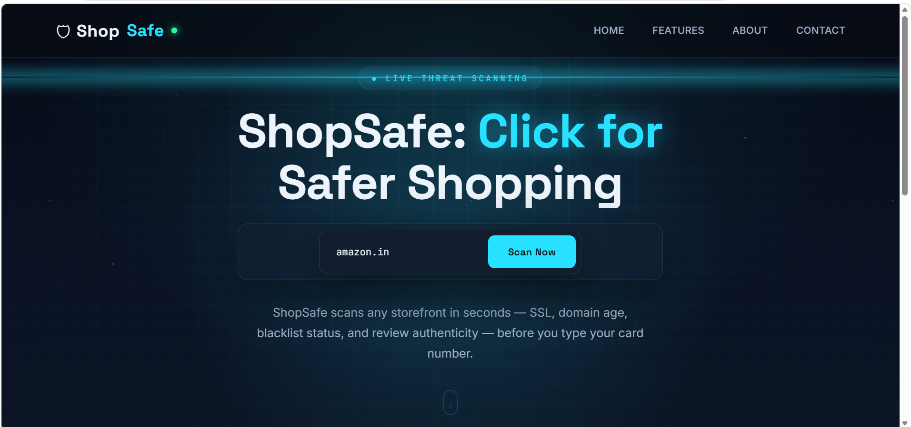
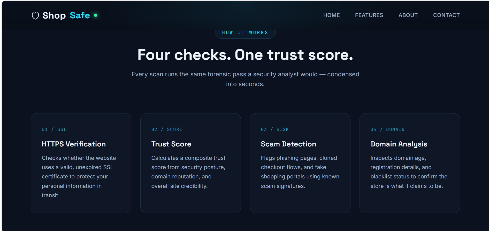
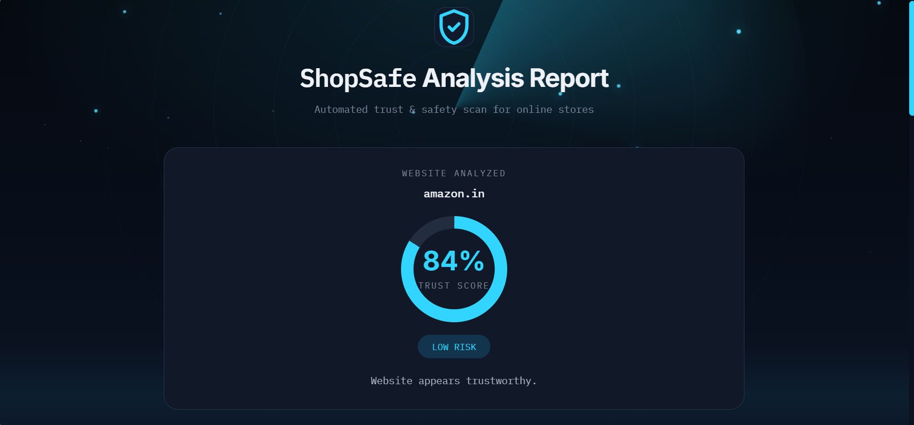
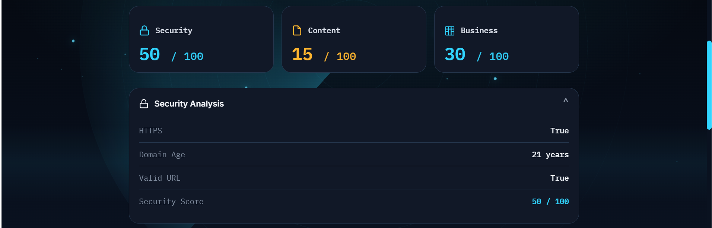
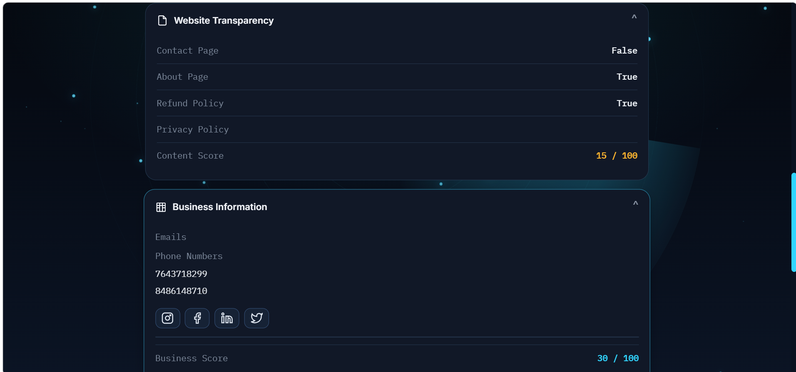
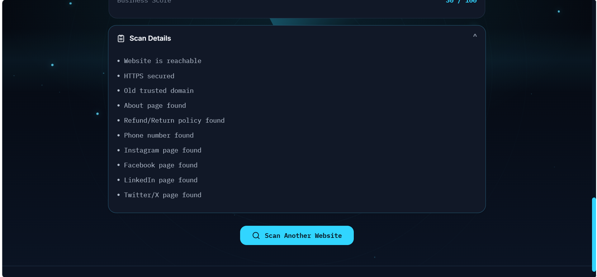

<div align="center">

# 🛡️ ShopSafe
### Intelligent E-Commerce Trust & Scam Detection System

**Click for safer shopping. Make more informed decisions before trusting an online store.**

[](https://www.python.org/)
[](https://flask.palletsprojects.com/)
[](https://www.crummy.com/software/BeautifulSoup/)
[](https://www.selenium.dev/)

*A team-developed web application that evaluates online storefronts using security, website-content, and business-information checks, then presents an overall trust score and risk recommendation.*

</div>

---

## 📌 Overview

Online shoppers may encounter websites that look legitimate but provide limited information about their business or security. **ShopSafe** is a web-based project designed to help users assess an online store before making a purchase.

Users enter a website URL and receive an analysis report containing a trust score, a risk category, individual module scores, and reasons gathered during the scan. The system combines three checks—**Security Analysis, Website Content Analysis, and Business Information Analysis**—to produce an overall assessment.

> **Note:** ShopSafe is an educational decision-support project. Its results are indicators, not a guarantee that a website is safe or fraudulent.

## ✨ Key Features

- **URL validation and reachability check** — validates the submitted URL and checks whether the website responds.
- **HTTPS check** — identifies whether the submitted website uses an HTTPS URL.
- **Domain-age lookup** — attempts to retrieve domain registration information using WHOIS.
- **Website transparency checks** — searches page content for contact, about, and refund/return information.
- **Business information extraction** — searches accessible pages for email addresses, Indian-format phone numbers, and social media links.
- **Trust score calculation** — combines the scores from the three analysis modules using weighted scoring.
- **Risk recommendation** — displays a Low Risk, Medium Risk, or High Risk category based on the calculated score.
- **Detailed analysis report** — presents the overall score, module scores, findings, and reasons in a responsive dark-themed interface.

## 🧰 Technology Stack

| Technology / Library | Purpose |
|---|---|
| Python | Core application logic |
| Flask | Web application and routing |
| HTML5 | Page structure and templates |
| CSS3 | Styling, layout, animation, and responsive presentation |
| JavaScript | Front-end interaction and visual effects |
| Requests | HTTP requests to websites |
| BeautifulSoup4 | Parsing HTML and extracting website information |
| Selenium | Browser-based page loading for content analysis |
| WebDriver Manager | Managing the Microsoft Edge WebDriver |
| `validators` | URL validation |
| `python-whois` | Retrieving domain registration details |
| `re` and `urllib.parse` | Pattern matching and URL handling |

## ⚙️ How It Works

```text
User enters a website URL
          │
          ▼
     Flask Application
          │
          ▼
   ┌──────┼─────────┐
   ▼      ▼         ▼
Security Content  Business
Analysis Analysis Analysis
   └──────┼─────────┘
          ▼
    Trust Score Module
          │
          ▼
 Weighted Score + Risk Level
          │
          ▼
   Analysis Report in Browser
```

### Analysis Modules

| Module | What it checks |
|---|---|
| **Security Analysis** | URL validity, website reachability, HTTPS usage, and available domain-age information. |
| **Website Content Analysis** | Looks for contact, about, and refund/return-related information in the loaded page content. |
| **Business Information Analysis** | Extracts email addresses, phone numbers, and available Instagram, Facebook, LinkedIn, Twitter/X, and WhatsApp links from selected pages. |
| **Trust Score Module** | Combines the three module scores using weights of 40% for security, 30% for content, and 30% for business information, then assigns a risk category. |

### Risk Categories

| Trust Score | Category | Recommendation |
|---|---|---|
| 80–100 | **Low Risk** | Website appears trustworthy. |
| 60–79 | **Medium Risk** | Proceed carefully before making payments. |
| Below 60 | **High Risk** | This website may not be trustworthy. |

The score is based on the checks implemented in the project and should not be treated as a definitive security verdict.

## 🖥️ Screenshots

### 1. Home Page

The landing page allows users to enter a website URL and start an analysis.

<div align="center">
  
</div>

### 2. Features and Analysis Workflow

The features section introduces the main checks used by ShopSafe.

<div align="center">
  
</div>

### 3. Trust Score Report

The result page displays the overall trust score and risk recommendation.

<div align="center">
  
</div>

### 4. Security Analysis

The security section displays URL validity, HTTPS status, domain age, and the security module score.

<div align="center">
  
</div>

### 5. Website Content and Business Information

The report shows website transparency findings and extracted business contact details.

<div align="center">
  
</div>

### 6. Scan Findings

The scan details section summarizes findings collected during the analysis.

<div align="center">
  
</div>

## 📁 Project Structure

```text
ShopSafe_project/
├── app.py
├── security_checker.py
├── content_checker.py
├── business_checker.py
├── trust_score.py
├── templates/
│   ├── shopsafe.html
│   └── result.html
├── screenshots/
│   ├── home.png
│   ├── home1.png
│   ├── trust_score.png
│   ├── trust_details1.png
│   ├── trust_details2.png
│   └── trust_details3.png
└── README.md
```

## 🚀 Getting Started

### Prerequisites

- Python 3.x
- Git
- Microsoft Edge browser (used by Selenium in the content-analysis module)
- Internet access for website checks and domain lookups

### 1. Clone the repository

```bash
git clone https://github.com/krithikadevadiga11/ShopSafe_project.git
cd ShopSafe_project
```

### 2. Create and activate a virtual environment (recommended)

**Windows — Command Prompt**
```bat
python -m venv venv
venv\Scripts\activate
```

**Windows — Git Bash**
```bash
python -m venv venv
source venv/Scripts/activate
```

### 3. Install the dependencies

```bash
pip install Flask requests beautifulsoup4 selenium webdriver-manager validators python-whois
```

### 4. Run the application

```bash
python app.py
```

Open the local address shown in the terminal—by default, Flask uses:

```text
http://127.0.0.1:5000/
```

Enter a website URL in the input field and select **Scan Now** to view the report.

## ⚠️ Current Limitations

- Website responses and layouts differ, so some pages may block automated requests or return incomplete information.
- Content analysis uses Selenium and waits for page loading; this can make scans slower.
- WHOIS data may be unavailable or inconsistent for some domains.
- Keyword-based content checks can miss information or identify terms without fully understanding their context.
- Finding contact details or social media links does not prove that a business is legitimate.
- The project does not replace professional security analysis, independent research, or safe payment practices.

## 🔮 Future Enhancements

- Improve scan speed and handling of websites that block automated access.
- Refine content checks to reduce false positives and false negatives.
- Add more robust threat-intelligence and reputation data sources.
- Improve error handling and explain unavailable results more clearly.
- Add automated tests and deployment configuration.
- Evaluate the scoring method against a broader set of known legitimate and suspicious websites.

## 🏆 Project Achievement

**Third Place — College-Level Project-Based Learning (PBL) Competition**

ShopSafe was developed as a team project and received third place in the college-level PBL competition.

## 👥 Team Members & Contributions

This project was developed collaboratively. The contribution descriptions below identify the intended module and development responsibilities; adjust them if your team's actual work division differs.


## 👥 Team Members & Contributions

| Team Member | Contribution Area |
|---|---|
| **Ankitha** | Backend development, security and content analysis, and application integration |
| **Deekshitha** | Business information analysis module and Trust Score Module |
| **Dhrithi P** | Frontend development and interface implementation |
| **Krithika M Devadiga** | Frontend development, UI styling, and interface implementation |


## 📄 License

No license has been specified for this repository. Unless a license is added, reuse and redistribution may be restricted by default.

---

<div align="center">

**ShopSafe — Think before you click. Shop with awareness.**

</div>
